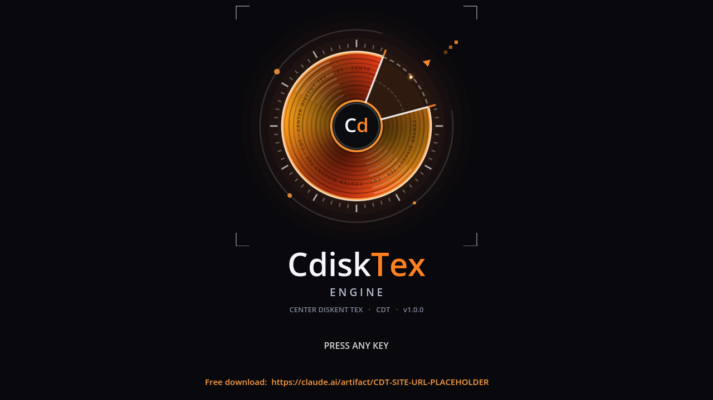

# CdiskTex Engine (CDT) — Center Diskent Tex

One GDScript file for Godot 4.4+. Drop it into any 3D project and get Counter-Strike style movement:
bunnyhop, air strafing, crouch, stair stepping, ladders, 64 tick, CS mouse sensitivity.
It installs itself and shows the CdiskTex logo before your game starts. Free.



## Download
Click **Code → Download ZIP** on this page, or download `cdisktex_engine.gd` directly.
Website with the same download: open `index.html` (or enable GitHub Pages for this repo).

## Install
**A. Autoload:** copy `cdisktex_engine.gd` into your project, then Project → Project Settings → Globals → Autoload,
pick the file, name it `CDT`, press Add.

**B. Attach once:** copy the file, attach it as a script to any Node in any scene. It is a `@tool` script,
so it registers itself as the `CDT` autoload and saves `project.godot`.

Run the game. CDT takes over `CharacterBody3D` nodes named `player` (or in group `player` / `cdt_player`,
origin at the feet) or spawns its own first-person player.

## Controls
WASD move · Space / mouse wheel jump · Ctrl crouch · Shift walk · F3 HUD · F4 next preset · F5 autohop · F6/F7 sensitivity

## API
```gdscript
CDT.set_preset("csgo")            # cs2 | csgo | css | hl2
CDT.spawn_player(Vector3(0, 1, 0))
CDT.attach(my_body)               # CharacterBody3D, origin at the feet
CDT.cfg["autohop"] = true
CDT.save_cfg()
```

## Measured (Godot 4.4.1, 64 tick)
Jump apex 57.0 u · 0→250 u/s in 12 ticks · stop in 26 ticks · ~460 u/s after 11 air-strafed hops (cs2/css) ·
17 u step climbed, 19 u blocked.

## Limits
No sub-tick input, no CS:GO stamina, approximate surfing, 3D only. Independent re-implementation of the
published movement formulas; not Source or Source 2 and contains no Valve code. Not affiliated with Valve.

## License
MIT, see `LICENSE`.
